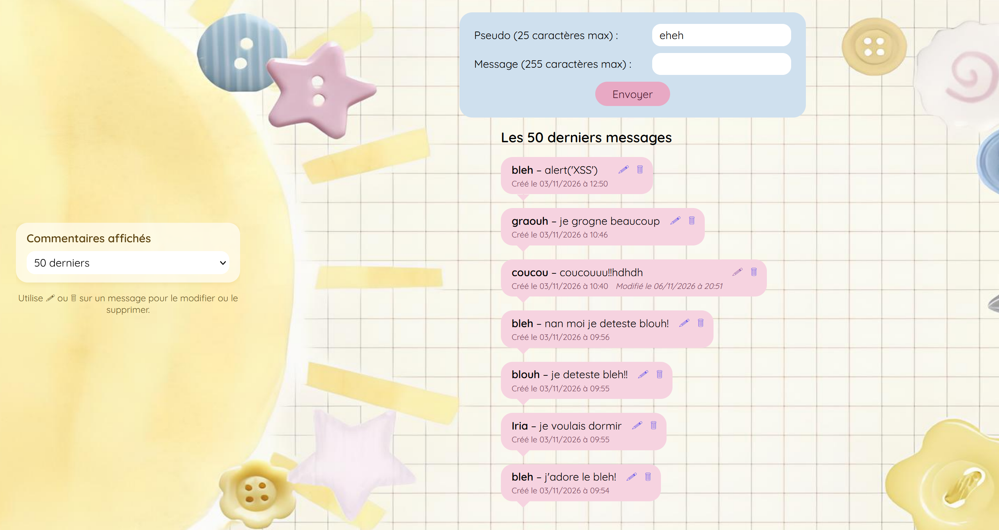

#  MiniChat en PHP/MySQL

Adaptation de l'ancien fil rouge du cours d'OpenClassrooms **« Concevez votre site web avec PHP et MySQL »**.

MiniChat est un petit chat web : on saisit un pseudo et un message, ils sont enregistrés en base de données et affichés dans la liste des derniers messages. Chaque message peut ensuite être modifié ou supprimé.

## Aperçu




##  Objectifs

### Version 1

-  Réaliser une base de données en SQL (utilisation du SGBD MySQL)
-  Utiliser un objet de connexion (PDO)
-  Afficher le contenu d'une table dans une page web (les *n* derniers commentaires)
-  Ajouter un commentaire en base de données
-  Se protéger des failles XSS (via la suppression ou l'échappement des balises)
-  Découvrir les [variables de session](https://www.php.net/manual/fr/reserved.variables.session.php)

### Version 2

-  Permettre à l'utilisateur de choisir le nombre de commentaires à afficher
-  Pouvoir modifier un commentaire spécifique (dissocier date de création et date de modification)
-  Pouvoir supprimer un commentaire spécifique (avec confirmation de suppression)

##  Fonctionnalités

- **Envoi de messages** : pseudo (25 caractères max) et message (255 caractères max).
- **Pseudo mémorisé** grâce à une variable de session : il est pré-rempli à chaque nouvel envoi.
- **Nombre de messages au choix** : 5, 10, 20 ou 50 derniers messages, conservé en session.
- **Modification** d'un message via l'icône 🖉, avec enregistrement d'une date de modification distincte.
- **Suppression** d'un message via l'icône 🗑, avec une étape de confirmation avant effacement définitif.
- **Protection contre les failles XSS** à l'enregistrement (`strip_tags`) et à l'affichage (`htmlspecialchars`).
- **Requêtes préparées PDO** pour se protéger des injections SQL.

##  Structure du projet

```
MiniChat/
├── index.php              # Page principale : formulaire, liste, modification / suppression
├── connexion.php          # Connexion à la base de données (PDO)
├── traitementTchat.php    # Ajout d'un message
├── modifierTchat.php      # Modification d'un message
├── supprimerTchat.php     # Suppression d'un message
├── style.css              # Mise en forme
├── imagefond.jpg          # Image de fond
└── screenshot.png         # Capture d'écran pour le README
```

##  Installation

### Prérequis

- PHP 8 ou supérieur, avec l'extension PDO MySQL
- MySQL ou MariaDB
- Un serveur local (XAMPP, WAMP, MAMP, Laragon…) ou le serveur intégré de PHP

### 1. Cloner le dépôt

```bash
git clone https://github.com/m0mong4/MiniChat.git
cd MiniChat
```

### 2. Créer la base de données

```sql
CREATE DATABASE minichat CHARACTER SET utf8mb4 COLLATE utf8mb4_general_ci;
USE minichat;

CREATE TABLE messages (
    id                INT UNSIGNED NOT NULL AUTO_INCREMENT PRIMARY KEY,
    pseudo            VARCHAR(25)  NOT NULL,
    message           VARCHAR(255) NOT NULL,
    date_message      DATETIME     NOT NULL,
    date_modification DATETIME     NULL DEFAULT NULL
);
```

### 3. Configurer la connexion

Modifier `connexion.php` avec vos propres paramètres :

```php
$host     = "localhost";
$dbname   = "minichat";
$username = "root";
$password = "";
```


### 4. Lancer le projet

Placer le dossier dans le répertoire de votre serveur local (`htdocs`, `www`…), puis ouvrir `http://localhost/MiniChat/`.

Ou bien, avec le serveur intégré de PHP :

```bash
php -S localhost:8000
```

puis ouvrir `http://localhost:8000`.

##  Sécurité

| Risque | Protection mise en place |
| --- | --- |
| Faille XSS | `strip_tags()` à l'enregistrement et `htmlspecialchars()` (fonction `h()`) à l'affichage |
| Injection SQL | Requêtes préparées PDO (`prepare` / `execute`) |
| Suppression accidentelle | Page de confirmation, suppression uniquement via `POST` |

##  Ressources

- [Cours OpenClassrooms : Concevez votre site web avec PHP et MySQL](https://openclassrooms.com/fr/courses/918836-concevez-votre-site-web-avec-php-et-mysql)
- [Documentation PHP : PDO](https://www.php.net/manual/fr/book.pdo.php)
- [Documentation PHP : sessions](https://www.php.net/manual/fr/reserved.variables.session.php)
